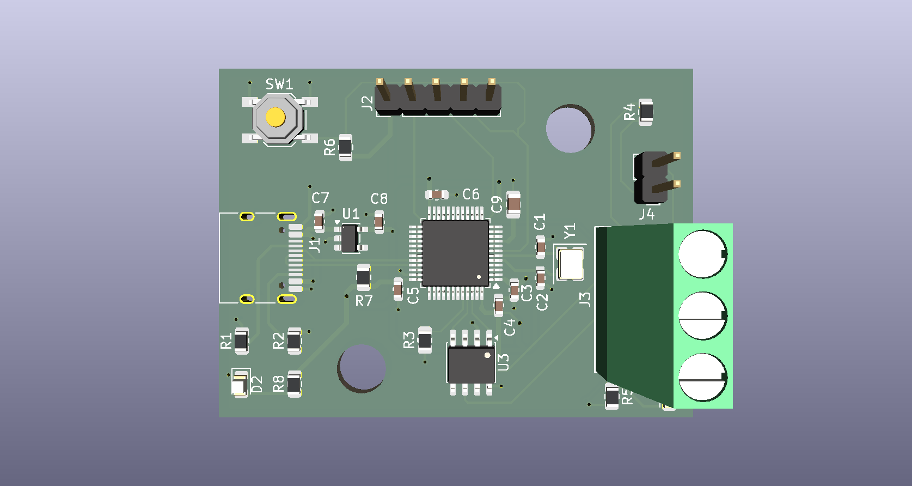
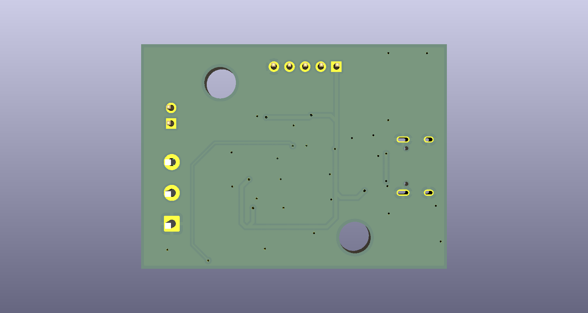
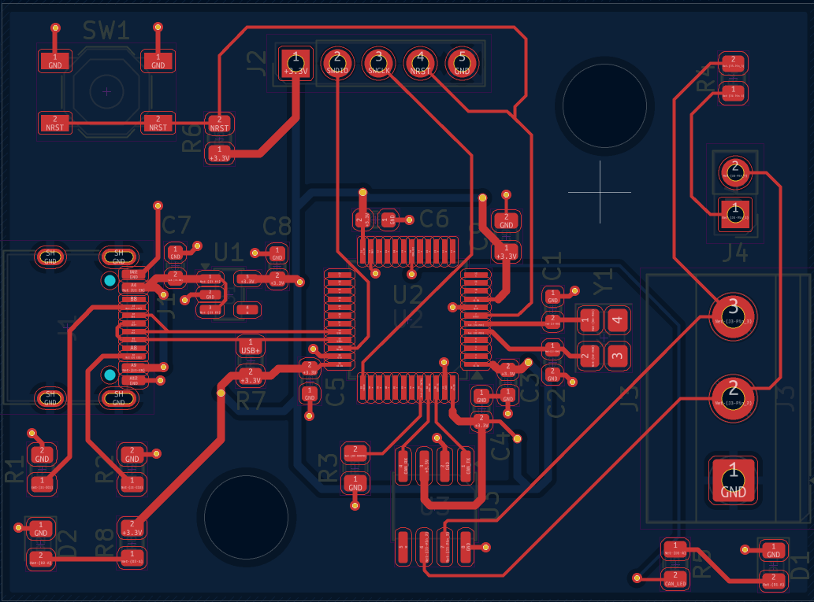
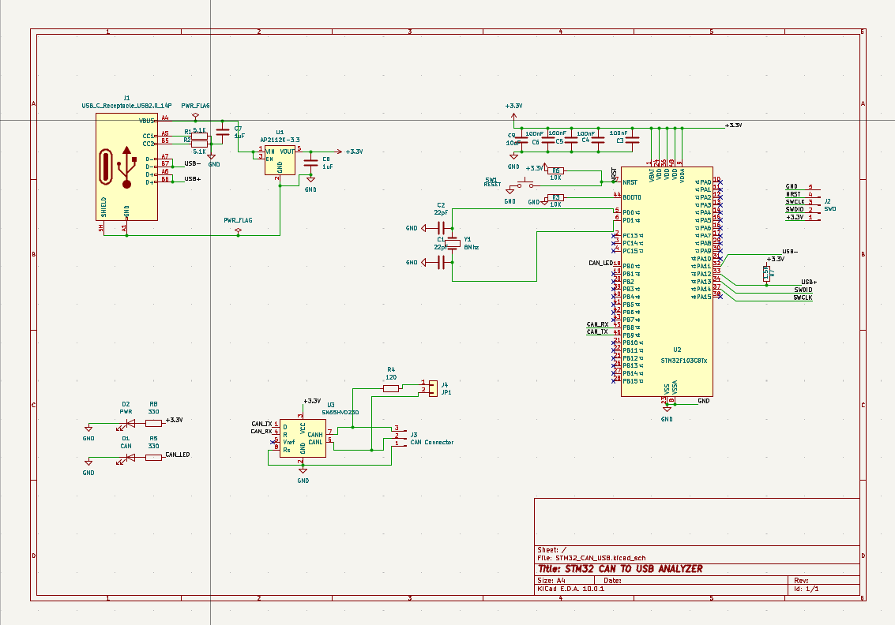

# STM32F103 CAN Interface PCB

A custom 2-layer PCB designed in KiCad featuring an STM32F103CBT6 microcontroller, SN65HVD230 CAN transceiver, USB Type-C power input, SWD programming interface, and selectable CAN bus termination.

> This repository contains hardware design files only. No firmware has been implemented at this stage.

---

## Features

* STM32F103CBT6 microcontroller
* SN65HVD230 CAN transceiver
* USB Type-C power input
* AP2112K-3.3 voltage regulator
* External 8 MHz crystal oscillator
* SWD programming/debug interface
* Jumper-selectable 120Ω CAN termination
* Power indicator LED
* CAN activity LED
* 2-layer PCB design

---

## 3D Render

### Front View



### Back View



---

## PCB Layout



---

## Schematic



---

## Main Components

| Component              | Description                |
| ---------------------- | -------------------------- |
| STM32F103CBT6          | Main Microcontroller       |
| SN65HVD230             | CAN Transceiver            |
| AP2112K-3.3            | 3.3V LDO Regulator         |
| USB Type-C Connector   | Power Input                |
| 8 MHz Crystal          | System Clock Source        |
| SWD Header             | Programming & Debugging    |
| 120Ω Resistor + Jumper | Selectable CAN Termination |

---

## Design Tools

* KiCad 10
* STM32CubeMX (planned)
* STM32CubeIDE (planned)

---

## Repository Structure

```text
.
├── README.md
├── Hardware/
│   ├── STM32_CAN_USB.kicad_sch
│   ├── STM32_CAN_USB.kicad_pcb
│   ├── STM32_CAN_USB.kicad_pro
│   └── STM32_CAN_USB.pdf
│
├── Images/
│   ├── pcb-top.png
│   ├── pcb-3d-front.png
│   ├── pcb-3d-back.png
│   └── schematic.png
│
└── Gerbers/
```

---

## Project Scope

This project was created to practice:

* Schematic capture
* Component selection
* Power distribution design
* USB Type-C integration
* CAN transceiver integration
* STM32 hardware design
* PCB layout and routing
* Manufacturing file generation

---

## License

MIT License
