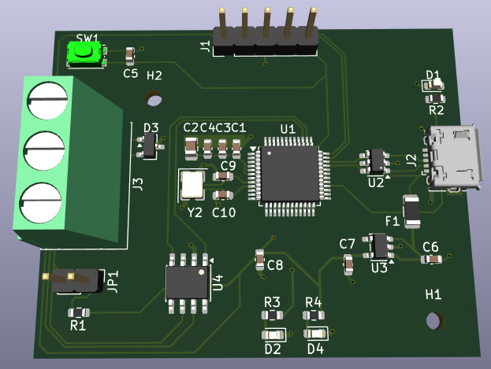
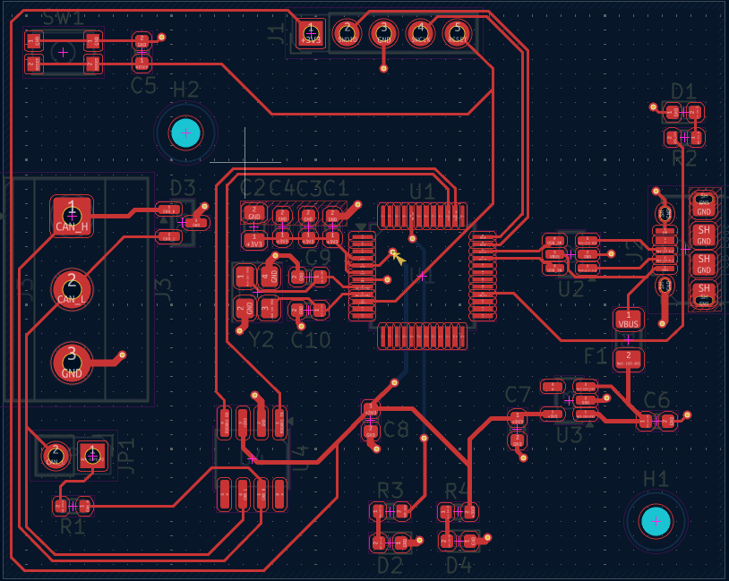
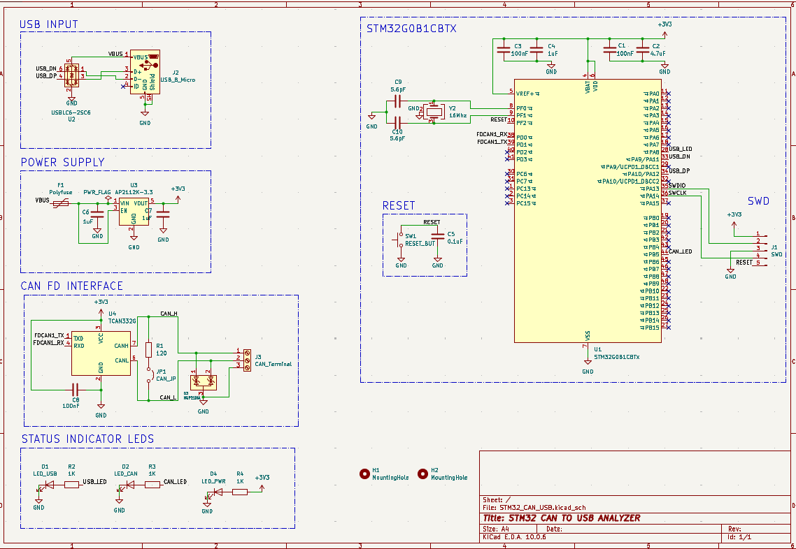

# STM32 USB-to-CAN FD Adapter

A USB-to-CAN adapter designed in KiCad around the STM32G0B1CBT6. It connects to a PC over USB and interfaces with a CAN bus through an external CAN transceiver.

## Features

- Micro-USB Type-B connection with USB Full-Speed
- STM32G0B1CBT6 microcontroller with USB and FDCAN peripherals
- TCAN332GD 3.3 V CAN transceiver
- USB ESD protection using USBLC6-2SC6
- CAN bus protection using NUP2105L
- AP2112K-3.3 regulator for the 3.3 V supply
- Jumper-selectable 120 Ω CAN termination
- SWD programming and debugging header
- Power and status LEDs
- Two-layer PCB with bottom-layer ground copper

## Hardware

| Component | Part |
|---|---|
| Microcontroller | STM32G0B1CBT6 |
| CAN transceiver | TCAN332GD |
| USB ESD protection | USBLC6-2SC6 |
| CAN protection | NUP2105L |
| Voltage regulator | AP2112K-3.3 |
| Crystal | ECS-160-12-33B2Q-CES-TR, 16 MHz |
| USB connector | Micro-USB Type-B |
| CAN connector | 3-pin screw terminal |

## PCB Design

### 3D View

### PCB Layout

### Schematic

## Design Specifications

- **EDA:** KiCad
- **PCB layers:** 2
- **Target dimensions:** 50 × 40 mm
- **Logic voltage:** 3.3 V
- **USB:** Full-Speed device interface
- **CAN:** CAN / CAN FD-capable hardware interface
- **Isolation:** Non-isolated

USB compatibility and CAN FD performance depend on configuration and validation on physical hardware.

## Repository Contents

- `Hardware/` — KiCad schematic, PCB, and project files
- `Manufacturing/gerbers/` — Gerber fabrication files
- `Manufacturing/drill/` — drill file
- `Docs/` — PCB renders, layout image, and schematic image
